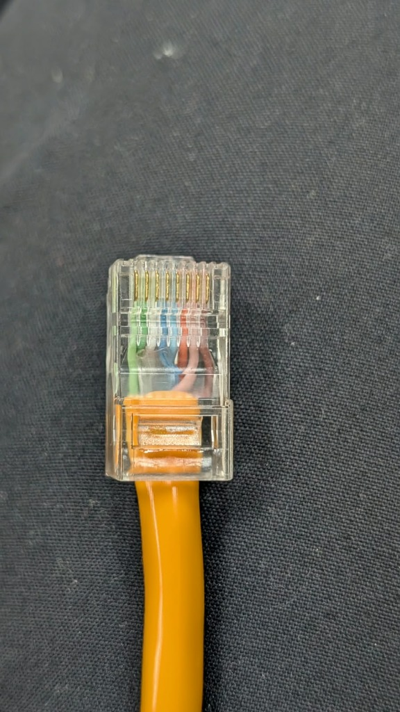
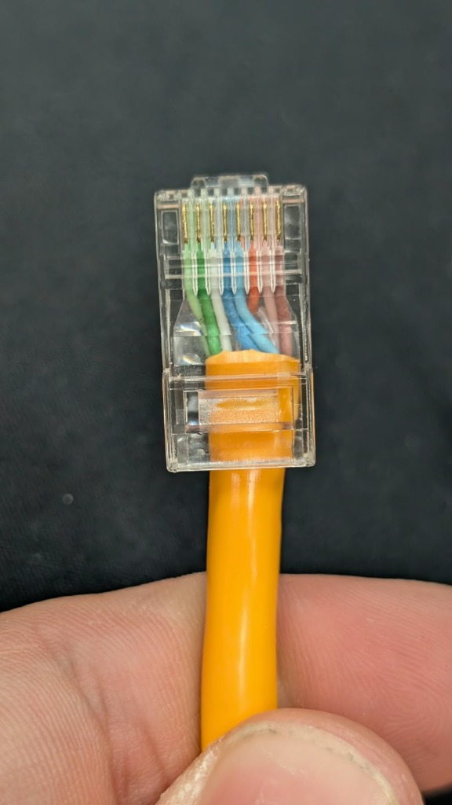
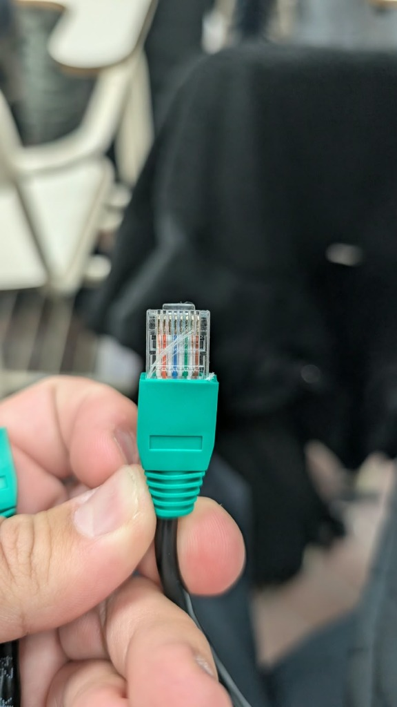
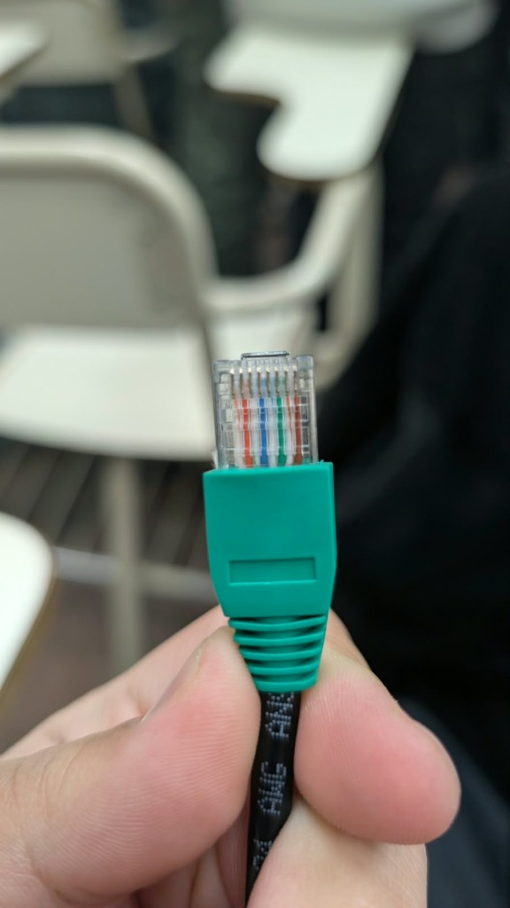
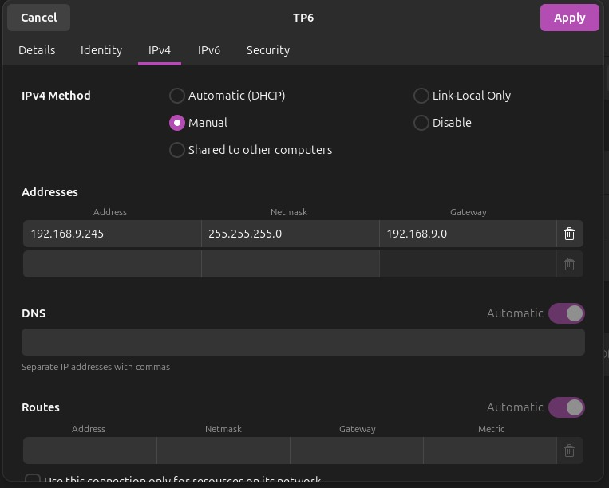
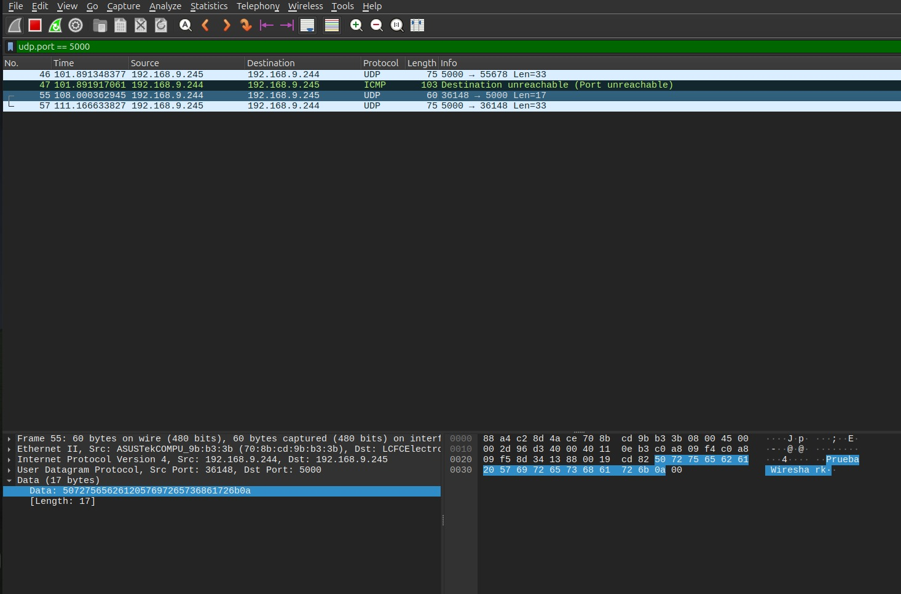
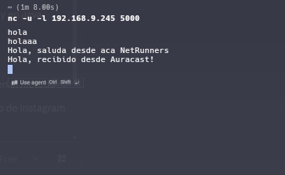
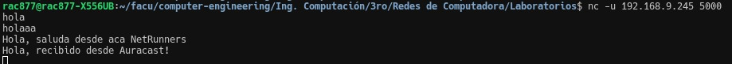
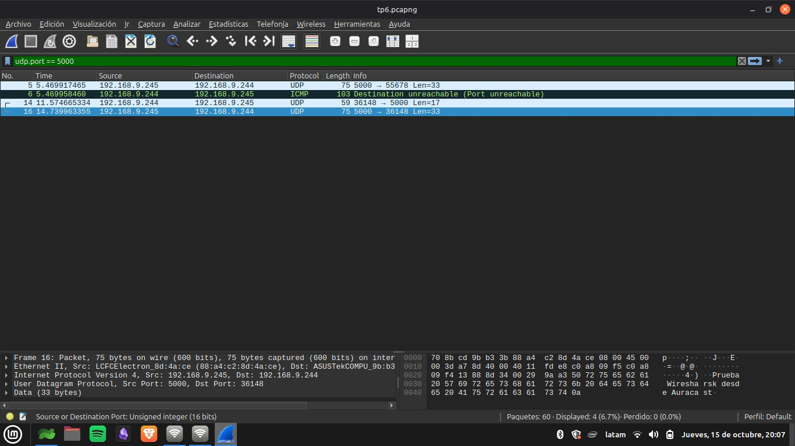
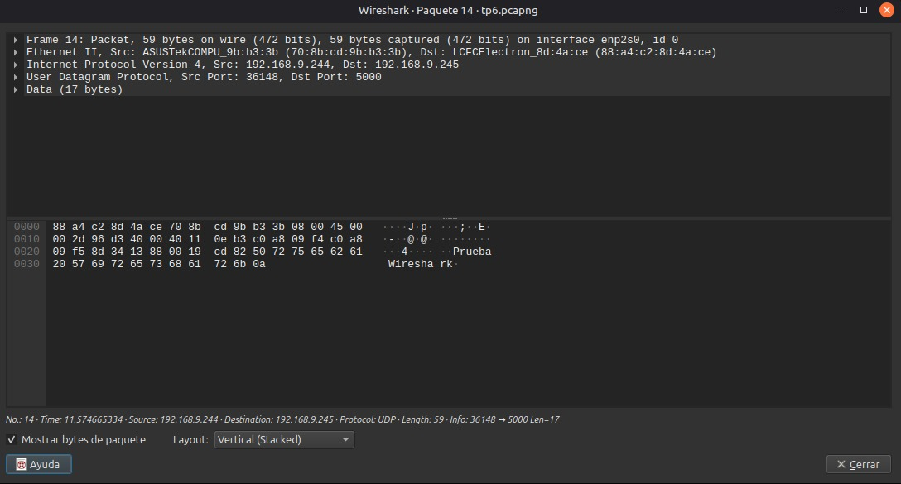

# Trabajo Práctico N°6 — Resolución

---

## Parte 1: Taller de armado y verificación de cables Cat5/Cat5e bajo estándar T568A/B

### Objetivos

- Tomar contacto con elementos de la capa física y ganar experiencia en armado y verificación de conexiones de red.

---

### Consignas

#### 1) Investigar los pasos para crimpar un cable bajo la norma T568A/B DERECHO (No cruzado).

**Esquema de colores (Norma T568B):**

1. Blanco Naranja
2. Naranja
3. Blanco Verde
4. Azul
5. Blanco Azul
6. Verde
7. Blanco Marrón
8. Marrón

*(Desarrollo de los pasos de crimpado aquí...)*

---

#### 2) Construir 1 (un) cable por grupo (1 - 1.5 m aprox., tipo DERECHO).

- **Cable construido (UTP Cat5e / Norma T568B - Directo):**




---

#### 3) VERIFICAR la buena construcción de un cable (intercambio con otro grupo).

##### a) Inspección visual para la calidad constructiva

*(Observamos que el cable de nuestro compañeros tiene desperfectos conforme a nylon del cable UTP, el cual esta atravesado sobre los conductores. Esto puede traer falsos contactos, perdida de velocidad, interferencias o perdida de paquetes. Pero algo positivo que tiene es el recubrimiento, el cual el nuestro no posee)*




##### b) Verificación eléctrica utilizando un tester para cables Ethernet

*(Resultado de la prueba del tester en la carpeta videos)*

---

#### 4) Documentación de intercambio y proceso técnico

- **Grupo con el que se intercambió: PingFloyd**
- **Evidencias fotográficas / videos:**
  - Fotos del cable propio y del cable intercambiado incorporadas en `imagenes/`.
  - Videos del testeo de continuidad disponibles en `videos/`.

---

## Parte 2: Equipamiento físico, verificación y utilización de equipos de red y generación de tráfico

### Objetivos

- Tomar contacto con equipamiento físico, reconocer su anatomía, paneles, indicadores, interfaces y funciones.
- Utilizar un switch empresarial (configurable).
- Análisis de tráfico UDP.
- Asignación de direcciones.

---

### Opcional

#### 1) Características principales del switch Cisco Catalyst 2950 Series

*(Documentación a partir del datasheet oficial...)*

#### 2) Checklists de procedimientos

##### a) Conectar PC al puerto de consola del switch Cisco a 9600 baudios con PuTTY

*(Paso a paso, parámetros de conexión serie y verificación...)*

##### b) Acceder a las opciones de administración del switch y levantar varias interfaces

*(Comandos de configuración Cisco IOS...)*

---

### Levantar y testear una LAN

#### 1) Configuración MANUAL de la interfaz de red

- **a) Dirección IPv4:** 192.168.9.245
- **b) Máscara de subred:** 255.255.255.0 (/24)
- **c) Default gateway:** 192.168.9.0
- **d) Justificación de las direcciones elegidas:** 
Las direcciones pertenecen al rango privado de Clase C (192.168.0.0/16), adecuadas para una red de laboratorio local e aislada.
La máscara /24 sitúa a ambas computadoras dentro de la misma subred IP (192.168.9.0/24), lo que permite la comunicación directa a nivel de capa de enlace (Switch) sin necesidad de un router intermedio. La puerta de enlace (192.168.9.0) no era estrictamente necesaria para el tráfico local en el mismo switch, pero valida la sintaxis de configuración del adaptador.



---

#### 2) Conexión y prueba de conectividad mediante Switch

- Conexión al switch Cisco mediante los cables armados en la Parte 1.
- Prueba de conectividad con `ping` hacia la PC del otro grupo:



---

#### 3) Establecimiento de receptor y emisor UDP con `ncat`

- Receptor:
  ```bash
  ncat -u -l 5000
  ```


- Emisor:
  ```bash
  ncat -u <IP_DESTINO> 5000
  ```
  

---

#### 4) Captura de paquetes UDP con Wireshark




---

#### 5) Preguntas teóricas y análisis

##### a) ¿Se observa algún procedimiento de establecimiento de conexión antes de enviar los datos?

No. En las capturas de Wireshark (udp.port == 5000) se observa que las tramas UDP se transmiten de forma directa e inmediata tan pronto como se envía el mensaje desde la consola. No existe ningún intercambio previo de señalización o saludo (como el 3-way handshake SYN, SYN-ACK, ACK de TCP). UDP es un protocolo no orientado a la conexión (connectionless).

##### b) ¿Existe algún mecanismo de confirmación de recepción equivalente a los ACK de TCP?

No. En la captura no se genera ningún paquete de confirmación o acuse de recibo (ACK) por parte del protocolo UDP. UDP funciona bajo el esquema de "mejor esfuerzo" (Best Effort): envía los datagramas a la red sin verificar si llegaron con éxito al destinatario.

##### c) ¿Qué ocurre si se envían mensajes mientras el receptor UDP no está ejecutándose?

En la captura de Wireshark se observa claramente que cuando la máquina cliente (192.168.9.244) envía un paquete UDP hacia el puerto 5000 sin que el servidor (192.168.9.245) tenga la aplicación receptor (nc) activa, el sistema operativo destino rechaza el paquete y responde inmediatamente con un mensaje del protocolo ICMP: *103 Destination unreachable (Port unreachable).*
El emisor simplemente transmite el paquete y la red le devuelve esta notificación de puerto inalcanzable a nivel de capa de red (ICMP).

##### d) ¿UDP garantiza que los mensajes lleguen en el mismo orden en que fueron enviados?

No. La cabecera de un datagrama UDP no posee campos para números de secuencia. Cada paquete se trata de manera independiente y autónoma dentro de la red. Si los datagramas sufren retardos o toman rutas diferentes, pueden llegar desordenados al destinatario. Si la aplicación requiere que lleguen en orden, debe implementarlo por su cuenta en la capa de aplicación.

##### e) ¿Qué aplicaciones reales utilizan UDP y por qué?

Streaming en tiempo real y VoIP (Zoom, Discord, llamadas por WhatsApp): Es preferible perder un paquete o un fotograma antes que introducir retardos por retransmisiones de paquetes viejos, ya que el factor crítico es la baja latencia.

Juegos en línea multijugador: Se transmiten actualizaciones continuas de posiciones y estados de los jugadores donde solo importa el dato más reciente.

DNS (Domain Name System): Realiza consultas cortas de pregunta/respuesta sobre el puerto UDP 53 donde el sobrecosto de establecer una conexión TCP resultaría ineficiente.

---

### Desarrollar un pequeño servidor

#### 1) Iniciar servidor HTTP con Python

```bash
python3 -m http.server 8000
```

*(Archivos preparados en el directorio: TXT, PDF e imagen...)*

---

#### 2) Acceso y descarga mediante navegador web

*(Acceso desde la segunda PC a `http://<IP>:8000` y descarga...)*

---

#### 3) Transferencia utilizando `curl` desde la terminal

```bash
curl -O http://<IP>:8000/<archivo>
```

*(Captura de la ejecución y transferencia...)*

---

#### 4) Captura del tráfico con Wireshark

- **¿De qué tipo de tráfico se trata?**
  *(Análisis de las capas TCP, HTTP y paquetes capturados...)*
